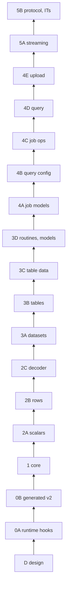

# BigQuery for Swift: modular design specs

These specs describe the Swift BigQuery library at
`pkgs/swift-google-cloud-bigquery`, module `GoogleCloudBigQuery`, a port of the
Java client (`java-bigquery/google-cloud-bigquery`). They are the design source
of truth for the stacked pull requests listed in [PLAN.md](PLAN.md). Slice D
adds this directory. Every code slice above it cites one or more sections here.

## Goals

- Cover every operation on Java's `BigQuery` interface: datasets, tables,
  routines, models, jobs (query, load, extract, copy), the query fast path,
  stateless queries, `insertAll`, `listTableData`, table IAM, and the
  resumable writer.
- Provide an idiomatic Swift 6 API: `async`/`await`, value types,
  `AsyncSequence`, `Codable`, and typed IDs.
- Keep the generated wire layer and the HTTP plumbing internal.
- Land the library as a stack of small slices that each build, test, and
  review on their own, bottom up.

## Non-goals

These are DEFERRED (see the parity table in [../bigquery.md](../bigquery.md)
section 11):

- The Storage Read API and Arrow.
- The beta `Connection` API.
- OpenTelemetry.
- Schema inference from `Encodable`.
- Whole-query job retry.
- Universe-domain credential checks (they belong in gax or auth).

## Global decisions

| ID | Decision | Rationale |
|---|---|---|
| D1 | Package `pkgs/swift-google-cloud-bigquery`, product and module `GoogleCloudBigQuery`. Same layout as `swift-google-cloud-storage`: `localOrRemotePackage` dependencies, shared `swiftSettings`, a `Tests` unit target, and a `Tests/IntegrationTests` target gated on `GOOGLE_CLOUD_PROJECT`. | One layout across the hand-written veneers, so CI and release tooling need no special cases. |
| D2 | `librarian` generates `generated/swift-google-cloud-bigquery-v2` (module `GoogleCloudBigQueryV2`). The veneer uses only its message types, as wire models, through a plain internal `import`. A hand-written internal `BigQueryTransport` on `GoogleGax._HTTPClient` and `_RetryLoop` sends the requests. | The generated client drops `error.errors[]`, fails on `204` deletes, and keeps its stubs internal. See [02-generated.md](02-generated.md#why-only-the-messages). |
| D3 | One `BigQueryClient` with async methods. Value-type resources and configs (no builders), typed IDs, `AsyncSequence` for lists and rows, typed row access plus `Decodable` decoding, one error type, resumable upload. Internals stay internal and are tested with `@testable import`. | Idiomatic Swift. Repository rule: never raise visibility for tests. |
| D4 | Scope is all of Java's `BigQuery` interface. The Read API, Arrow, Connection, and OTel are DEFERRED. | No generated Storage v1 module and no Swift Arrow dependency exist in the repository. |
| D5 | Swift Testing only. Unit tests cover the Java unit baseline. ITs cover the Java IT baseline and run live against `GOOGLE_CLOUD_PROJECT`, with unique resource names and cleanup. | [../bigquery_test_baseline.md](../bigquery_test_baseline.md). |
| Q1 | Job-creation mode is unset by default. It is available as `QueryJobConfiguration.jobCreationMode` and as `BigQueryClientOptions.defaultJobCreationMode`. The client never opts into `JOB_CREATION_OPTIONAL` silently. | Java parity. Optional mode changes which IDs are returned. |
| Q2 | `insertAll` generates a UUID `insertId` for every row that lacks one. Callers can supply IDs or opt out with `insertIDs: .none`, which also disables retries. | Retries without insert IDs can duplicate rows. Intentional difference from Java. |
| Q3 | Cancelling the Swift `Task` only stops waiting or paging. It never sends `jobs.cancel`. Server-side cancel is the explicit `cancelJob(_:)`. | A client task lifetime should not have server-side effects. |
| W1 | Every query sends `useLegacySql=false`, including view definitions. An absent value read back from the server means legacy SQL. | The server default is legacy SQL. |
| W2 | Every `jobs.query`, `getQueryResults`, and `tabledata.list` request sets `formatOptions.timestampOutputFormat=ISO8601_STRING`. | Keeps microsecond and picosecond precision. |
| W3 | Every `jobs.query` request carries a `requestId`. Job IDs are always generated client-side. | Makes create calls idempotent and safe to retry. |
| W4 | The fast-path decision uses an allowlist. | Java's denylist sends unknown new fields down the fast path. |
| W5 | Retries classify by HTTP status and `error.errors[].reason`. | More robust than Java's message regex. |
| W6 | Rows are paged lazily. `totalRows` is `UInt64?`, and the client never infers "no rows" from an absent count. | Avoids the Rust client's bug. |
| W7 | Waiting for a job throws when the job failed. | Avoids the Go client's footgun. |
| W8 | `BIGNUMERIC` uses a string-backed `BigNumeric` type. | Foundation `Decimal` has 38 digits. BIGNUMERIC needs 76.76. |

The flat document [../bigquery.md](../bigquery.md) section 2 records the
original board numbers behind these IDs.

## Source documents

The specs split and update the flat design set that slice 0B adds. Those files
stay where they are:

- [../bigquery.md](../bigquery.md): the original single-file design. Most
  wording here comes from it. Where the shipped code differs, these specs
  describe the code and say so in a `Notes` subsection.
- [../bigquery_reference_behavior.md](../bigquery_reference_behavior.md): the
  Java client's behavioral contract (cited there as B section numbers).
- [../bigquery_cross_language.md](../bigquery_cross_language.md): the Go,
  Python, Node, and Rust survey (S section numbers).
- [../bigquery_test_baseline.md](../bigquery_test_baseline.md): every Java test
  with a stable ID (`U.<Class>.NN`, `IT-NNN`).

## Spec files

| File | Layer | Slices |
|---|---|---|
| [00-overview.md](00-overview.md) | goals, decisions, cross-slice rules | D |
| [01-runtime.md](01-runtime.md) | shared runtime hooks in gax and wkt | 0A |
| [02-generated.md](02-generated.md) | generated wire module and release wiring | 0B |
| [03-core.md](03-core.md) | client, transport, IDs, errors, paging, schema | 1 |
| [04-values.md](04-values.md) | scalar types, rows, cells, decoding | 2A, 2B, 2C |
| [05-resources.md](05-resources.md) | datasets, projects, IAM, tables, table data, routines, models | 3A, 3B, 3C, 3D |
| [06-jobs.md](06-jobs.md) | job models, parameters, configurations, job operations | 4A, 4B, 4C |
| [07-query.md](07-query.md) | query execution and resumable upload | 4D, 4E |
| [08-performance.md](08-performance.md) | streaming row parsing and prefetch | 5A |
| [09-protocol.md](09-protocol.md) | mock seam, docs, integration tests, release | 5B |
| [PLAN.md](PLAN.md) | slices, bookmarks, PRs, fences, dependencies | D |

## Slice map

The stack is linear for review. The logical dependencies are narrower and are
recorded in the Depends On column of [PLAN.md](PLAN.md). A cascade from a
slice only needs to visit the slices that depend on it.

## Cross-slice rules

- All public types are `Sendable`. Value types are `Equatable`, and `Hashable`
  when every field allows it. Every type a method returns has a `public init`,
  so tests can build test doubles.
- Every RPC method ends with `options: GoogleGax.RequestOptions = .init()`.
  Other inputs are labeled parameters with defaults. There are no options
  structs for per-call flags.
- `get*` methods take `selectedFields: [String]? = nil` (as do some create
  and update methods, see [05-resources.md](05-resources.md#datasets)).
  `list*` methods take `pageSize: Int? = nil, pageToken: String? = nil` and
  return `PagedSequence`.
- Every enum-like server value is an extensible `RawRepresentable` struct with
  static constants, so an unknown wire value degrades gracefully. The only
  public `enum`s are closed shapes: `FieldValue`, `QueryParameters`, and
  `JobConfiguration`.
- No generated type appears in the public API. Only `GoogleGax` is a
  `public import`.
- A slice edits only the files in its scope fence (PLAN.md). A change to a
  contract in a lower slice is made in that slice and cascaded up, one commit
  per affected slice.
- Each slice builds and passes `test_cmd` and `lint_cmd` at its own head.
- Unit tests use one `@Suite struct` per type, no string descriptions on
  `@Test` or `@Suite`, and a `// Baseline: <IDs>` or `// Design: <section>`
  comment above each test.
- Design prose has no em-dashes and no semicolons.
